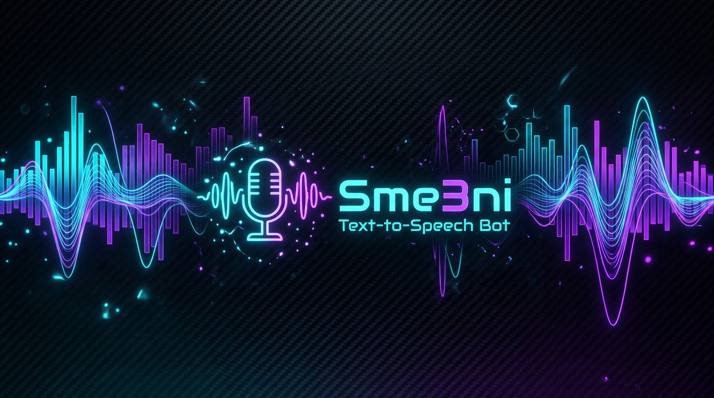

# Sme3ni ngollik — Discord Text-to-Speech (TTS) Bot 🗣️



A sleek, lightweight Discord bot that joins voice channels, speaks out messages or calls out users with natural Google Text-to-Speech, and immediately disconnects when finished.

---

## 🎙️ Slash Commands

### 1. `/say [text] [language]`
Speaks your message in your current voice channel:
```text
/say text: Hello everyone in the server!
/say text: Bonjour tout le monde language: French
/say text: Marhba bikom language: Arabic
```

### 2. `/tell [user] [text] [language]`
Mentions someone, calls them out by name in their voice channel, and speaks your message:
```text
/tell user: @Amine text: join the game lobby!
```
* The bot speaks: `"Amine, join the game lobby!"`
* If `@Amine` is in a voice channel, the bot automatically jumps into their voice room to deliver the message!

### 3. `/tts [text] [language]`
Quick shortcut alias for `/say`.

---

## 🌐 Supported Languages
* English (`en`) — Default
* Arabic (`ar`)
* French (`fr`)
* Spanish (`es`)
* German (`de`)
* Japanese (`ja`)

---

## 🚀 Setup & Self-Hosting

### Requirements
* Node.js v18+
* FFmpeg installed on system

### Installation
1. Clone the repository:
   ```bash
   git clone https://github.com/AmineLhb/TextToSpeech.git
   cd TextToSpeech
   ```
2. Install dependencies:
   ```bash
   npm install
   ```
3. Create a `.env` file with your Discord Bot Token:
   ```env
   DISCORD_TOKEN=your_bot_token_here
   ```
4. Start the bot:
   ```bash
   node index.js
   ```
   *(Or double-click `run.bat` on Windows)*

---

## 🔒 Required Bot Permissions
* View Channels
* Send Messages
* Connect
* Speak
* Use Application Commands (Slash Commands)
* Gateway Intents: Server Members Intent, Message Content Intent
